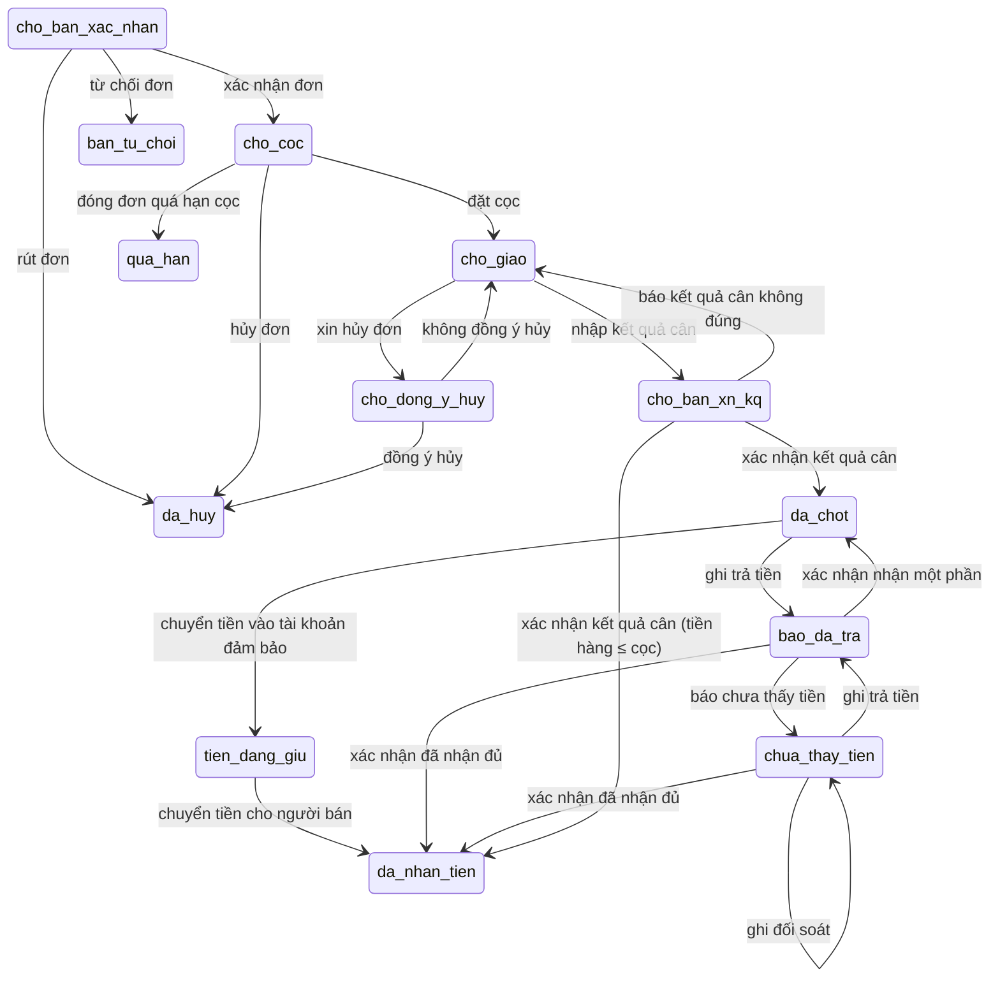

<!-- Tệp sinh tự động bằng `npm run tai-lieu`. Đừng sửa tay. -->

# Bảng trạng thái và bảng luật đơn

Nguồn: `packages/nghiep-vu/src/don/`. Mọi thay đổi trạng thái đơn đều đi qua bảng luật này; bước không có trong bảng thì không làm được.

## Trạng thái (13)

| Mã | Nhãn | Chặng | Loại |
|---|---|---|---|
| `cho_ban_xac_nhan` | Chờ người bán xác nhận đơn | 2. Đơn | Đang chạy |
| `ban_tu_choi` | Người bán từ chối đơn | 2. Đơn | Đóng, không thành |
| `cho_coc` | Chờ bên mua đặt cọc | 3. Cọc | Đang chạy |
| `qua_han` | Quá hạn đặt cọc, đơn đã đóng | 3. Cọc | Đóng, không thành |
| `cho_giao` | Đã cọc, chờ giao và cân | 4. Giao và cân | Đang chạy |
| `cho_dong_y_huy` | Có yêu cầu hủy, chờ bên kia trả lời | 4. Giao và cân | Đang chạy |
| `cho_ban_xn_kq` | Kết quả cân chờ người bán xác nhận | 5. Chốt | Đang chạy |
| `da_chot` | Đã chốt số cân, chờ trả tiền | 6. Tiền về | Đang chạy |
| `tien_dang_giu` | Tiền ở tài khoản đảm bảo, đang chuyển cho người bán | 6. Tiền về | Đang chạy |
| `bao_da_tra` | Bên mua báo đã trả, chờ người bán xác nhận | 6. Tiền về | Đang chạy |
| `chua_thay_tien` | Người bán chưa thấy tiền, đang đối soát | 6. Tiền về | Đang chạy |
| `da_nhan_tien` | Người bán đã nhận đủ, đơn đóng | đã xong | Đóng, thành công |
| `da_huy` | Đơn đã hủy | giữ chặng lúc hủy | Đóng, không thành |

## Các bước (20)

| Bước | Việc | Ai làm | Từ trạng thái | Sang trạng thái | Việc phụ |
|---|---|---|---|---|---|
| `rutDon` | rút đơn | Bên mua | `cho_ban_xac_nhan` | `da_huy` | có |
| `xacNhanDon` | xác nhận đơn | Người bán | `cho_ban_xac_nhan` | `cho_coc` |  |
| `tuChoiDon` | từ chối đơn | Người bán | `cho_ban_xac_nhan` | `ban_tu_choi` |  |
| `datCoc` | đặt cọc | Bên mua | `cho_coc` | `cho_giao` |  |
| `quaHanCoc` | đóng đơn quá hạn cọc | Hệ thống | `cho_coc` | `qua_han` |  |
| `huyTruocCoc` | hủy đơn | Người bán, Bên mua | `cho_coc` | `da_huy` | có |
| `yeuCauHuy` | xin hủy đơn | Người bán, Bên mua | `cho_giao` | `cho_dong_y_huy` | có |
| `dongYHuy` | đồng ý hủy | Bên không xin hủy | `cho_dong_y_huy` | `da_huy` |  |
| `tuChoiHuy` | không đồng ý hủy | Bên không xin hủy | `cho_dong_y_huy` | tùy trường hợp / giữ nguyên |  |
| `nhapKetQua` | nhập kết quả cân | Bên mua | `cho_giao` | `cho_ban_xn_kq` |  |
| `ketQuaDung` | xác nhận kết quả cân | Người bán | `cho_ban_xn_kq` | `da_chot` |  |
| `ketQuaSai` | báo kết quả cân không đúng | Người bán | `cho_ban_xn_kq` | `cho_giao` |  |
| `chuyenTienDamBao` | chuyển tiền vào tài khoản đảm bảo | Bên mua | `da_chot` | `tien_dang_giu` |  |
| `giaiNgan` | chuyển tiền cho người bán | Hệ thống | `tien_dang_giu` | `da_nhan_tien` |  |
| `baoDaTra` | ghi trả tiền | Bên mua | `da_chot`, `chua_thay_tien` | `bao_da_tra` |  |
| `tienDu` | xác nhận đã nhận đủ | Người bán | `bao_da_tra`, `chua_thay_tien` | `da_nhan_tien` |  |
| `nhanMotPhan` | xác nhận nhận một phần | Người bán | `bao_da_tra` | `da_chot` |  |
| `tienChua` | báo chưa thấy tiền | Người bán | `bao_da_tra` | `chua_thay_tien` |  |
| `guiChungTu` | gửi chứng từ | Bên mua | `chua_thay_tien` | tùy trường hợp / giữ nguyên | có |
| `ghiDoiSoat` | ghi đối soát | Người bán, Bên mua | `chua_thay_tien` | tùy trường hợp / giữ nguyên | có |

"Việc phụ" (rút, hủy, gửi chứng từ, ghi đối soát) không làm đơn chuyển sang nhóm "Bạn cần làm".

## Sơ đồ

## Chính sách mặc định (mô phỏng)

| Mục | Giá trị |
|---|---|
| Phí giới thiệu (đơn đầu với người bán này) | 1% |
| Phí mối quen (đơn sau) | 0.3% |
| Sàn / trần phí | 50.000 đ / 3.000.000 đ |
| Cọc | 10% giá trị đơn, làm tròn nghìn đồng |
| Hạn cọc | 48 giờ kể từ khi người bán xác nhận |
