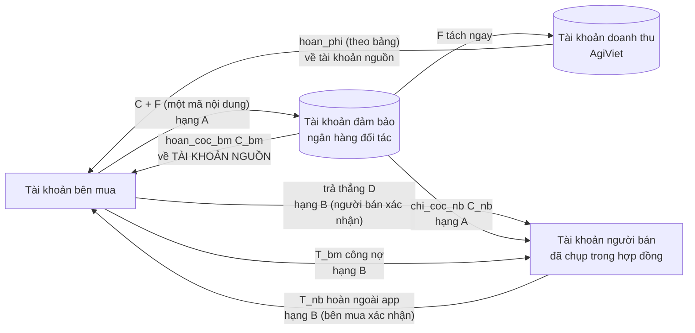
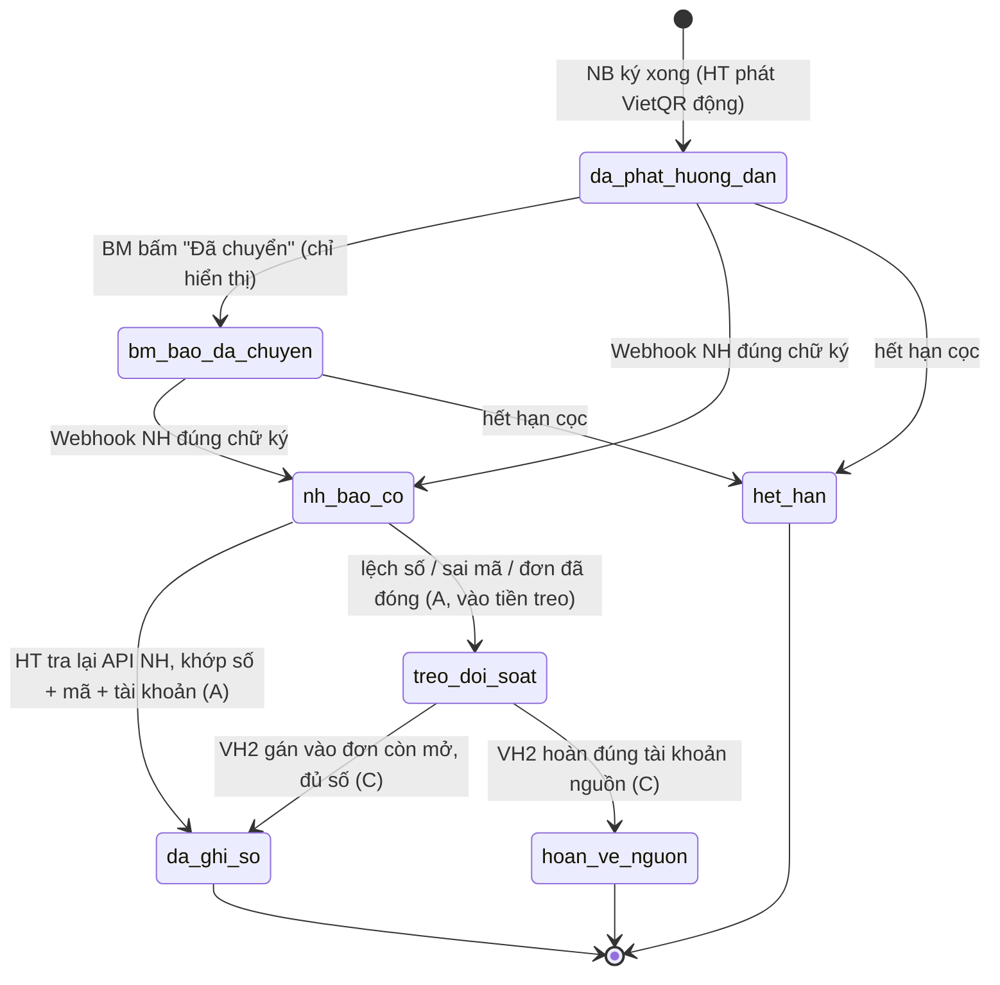
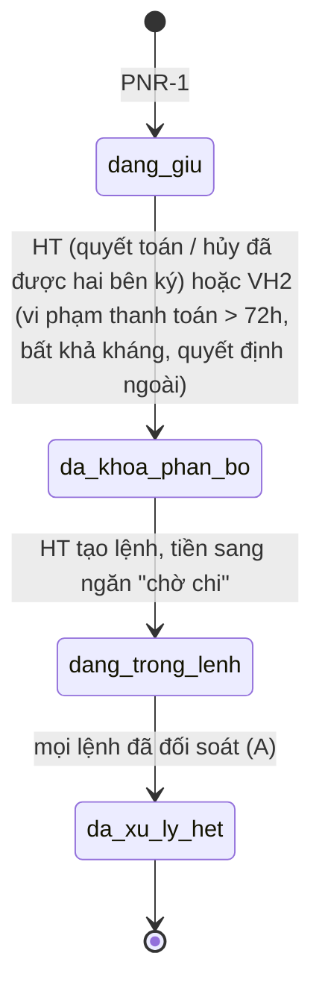
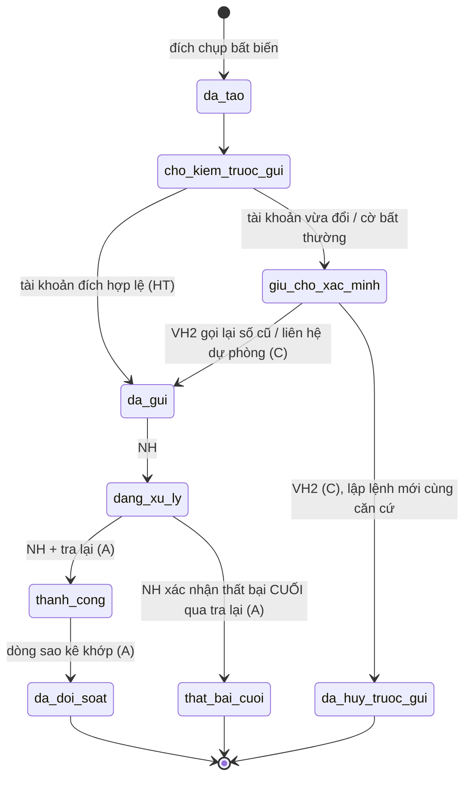
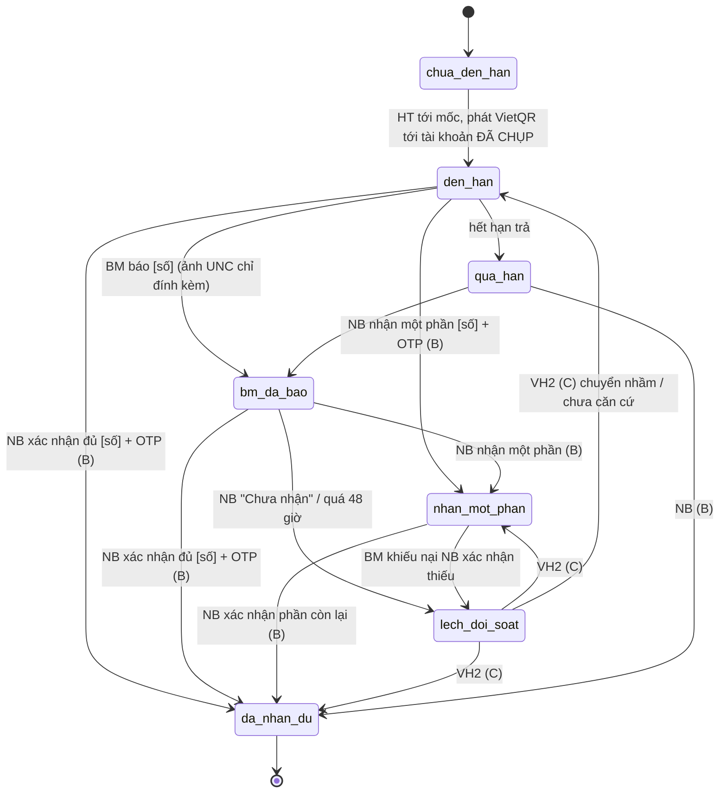
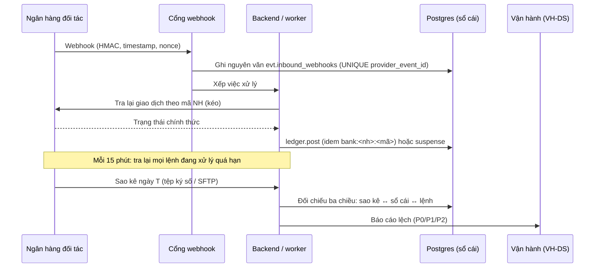

# 01 · Vòng đời dòng tiền: máy trạng thái, bằng chứng, điểm không quay lại, đối soát

Bản 25/10/2026. Người viết: kỹ sư bảo mật thanh toán. Căn cứ: `docs/nghiep-vu/03-vong-doi-don.md` (mục 5, 9, 11), `04-tien-va-coc.md`, `08-van-hanh-thu-cong.md`, lược đồ `db/migrations/0005`, `0007`.

Tài liệu này **thắt chặt** vòng đời tiền của đặc tả nghiệp vụ: không đổi công thức tiền (công thức ở `04`), mà chốt rõ cho mỗi bước: **ai được bấm, cần bằng chứng hạng nào, ghi sổ gì, khi nào không quay lại được, đối soát với ngân hàng ra sao**. Bản dạng dữ liệu của các máy trạng thái nằm ở `security/lib/money-lifecycle.mjs` và được kiểm tự động bằng `security/tests/unit/money-lifecycle.test.mjs` (tính chất đồ thị, xem mục 9).

Chữ dùng trong tài liệu kỹ thuật này: "tài khoản đảm bảo" = tài khoản do ngân hàng đối tác giữ, nơi cọc nằm. Giao diện vẫn theo bảng chữ cấm ở `00-tong-quan.md` mục 7 (không dùng "escrow", "giải ngân" trên màn).

## 1. Bảy luật nền (áp cho mọi khoản)

| # | Luật | Vì sao | Chặn ở đâu |
|---|---|---|---|
| L1 | **Chỉ hai nguồn được tạo "sự thật tiền":** (a) ngân hàng (sự kiện đúng chữ ký **và** tra lại API khớp, hoặc dòng sao kê); (b) **bên nhận tiền** tự xác nhận kèm số và OTP, chỉ cho tiền đi ngoài tài khoản đảm bảo. Mọi đường khác đi qua vận hành hai người với bằng chứng hạng C | Người trả tiền luôn có lợi khi nói "đã trả"; chỉ bên nhận hoặc ngân hàng nói được "đã vào" | Backend (thang bằng chứng `security/lib/evidence.mjs`), DB (đề xuất mục 8) |
| L2 | **Ảnh ủy nhiệm chi, ảnh màn hình app ngân hàng, lời báo, tin nhắn, cuộc gọi không phải bằng chứng.** Chỉ được đính kèm làm "đầu mối" cho đối soát | UNC chỉ chứng minh đã lập lệnh; dễ sửa ảnh, lệnh có thể bị trả lại | Backend: không có API nào nhận ảnh làm điều kiện chuyển trạng thái tiền |
| L3 | **Người giúp không có bước tiền nào**: không xác nhận nhận tiền, không ký, không đổi tài khoản, không nhận OTP tiền | K17, F03 | API (kiểm vai theo hành động), DB (trigger), OTP (không phát thử thách) |
| L4 | **Tiền đi ra chỉ tới tài khoản đã chụp** (lệnh chi người bán: tài khoản chụp trong phiên bản hợp đồng; hoàn bên mua: **tài khoản nguồn** đã nộp tiền, lấy từ sự kiện ngân hàng). Không bao giờ hoàn tới tài khoản do người dùng gõ | Chống chiếm tài khoản rồi đổi đích; chống rửa tiền qua "nộp tài khoản A, xin hoàn về tài khoản B" | DB (lệnh lưu đích bất biến), backend (kiểm trước gửi) |
| L5 | **Mỗi sự thật tiền ghi đúng một lần**: khóa chống lặp theo mã sự kiện ngân hàng, mã lệnh, mã quyết toán | Webhook lặp, bấm lặp, hai worker chạy song song | DB UNIQUE + khóa hàng |
| L6 | **Im lặng không bao giờ là "đã nhận tiền"** (K15, BT-T9). Hết hạn chỉ chuyển việc cho người hoặc áp hệ quả hợp đồng đã ký, không cộng tiền | Chống "treo cho hết hạn rồi tự coi như đã trả" | Máy trạng thái (không có chuyển hẹn giờ nào có `moneyFact`) |
| L7 | **Không sửa, chỉ ghi bù**: sai thì giao dịch đảo hoặc nghĩa vụ mới tham chiếu bản gốc, qua hai người | Bằng chứng trước trọng tài, tòa | DB append-only (đã có ở `0007`) |

### Thang bằng chứng

| Hạng | Gồm | Được dùng cho | Ai ghi |
|---|---|---|---|
| **A** | Sự kiện ngân hàng đúng chữ ký HMAC + timestamp + nonce **và** tra lại API ngân hàng khớp số tiền, mã tham chiếu, tài khoản; dòng sao kê ngày của tài khoản đảm bảo | Cọc vào, lệnh chi/hoàn thành công, đối soát | Hệ thống tự động |
| **B** | Bên **nhận** tiền xác nhận trong app trên máy mình: "Đã nhận đủ [số]" / "Nhận một phần [số]", có OTP mục đích `money_received` gắn mã khoản và số tiền | Trả thẳng, hoàn ngoài app, công nợ sau quyết toán | Hệ thống khi bên nhận bấm |
| **C** | Văn bản/API tra soát của ngân hàng bên trả xác nhận đã ghi có vào tài khoản đã chụp; sao kê do bên nhận cung cấp **được ngân hàng xác minh**; biên bản kiểm định có chữ ký kênh đối tác; quyết định có hiệu lực của trọng tài/tòa; văn bản thỏa thuận hai bên có OTP | Mọi chuyển trạng thái thủ công có hệ quả tiền | Vận hành hai người (lập ≠ duyệt) |
| — | Ảnh UNC, ảnh màn hình, lời báo, chat, cuộc gọi, lời nhân viên hiện trường | Chỉ là đầu mối | Không ai |

## 2. Bản đồ tiền của một đơn

Tiền không bao giờ đi qua tài khoản chi phí của AgiViet. Phí (F) đi vào tài khoản doanh thu do ngân hàng tách; **cần ngân hàng đối tác xác nhận năng lực tách khoản** (`05-tuan-thu.md` mục 2).

## 3. Máy trạng thái từng khoản

Ký hiệu tác nhân: NB người bán (chủ hoặc vai có quyền tiền), NG người giúp, BM bên mua (kế toán/quản lý), NH ngân hàng đối tác, HT hệ thống, VH2 vận hành hai người, KD kiểm định đối tác (kênh có chữ ký). Cột "PNR" đánh dấu điểm không quay lại.

### 3.1 Khoản nộp qua app (cọc + phí)

| Bước | Ai | Điều kiện / bằng chứng | Ghi sổ (đề xuất theo `0007`) | PNR |
|---|---|---|---|---|
| Phát hướng dẫn | HT | Hợp đồng đủ chữ ký hai bên trên cùng mã băm; VietQR **dựng ở máy chủ** tới tài khoản ảo của đơn tại ngân hàng, số = C + F, nội dung `AGV <mã đơn> COC` | Không | |
| BM báo đã chuyển | BM (kế toán/quản lý) | Không cần bằng chứng; ảnh UNC nếu có gắn nhãn "không phải bằng chứng" | Không | |
| NH báo có | NH | Chữ ký HMAC đúng, timestamp ±5 phút, nonce chưa dùng (`security/lib/webhook.mjs`); ghi nguyên văn `evt.inbound_webhooks` | Không | |
| Ghi sổ | HT | **Tra lại API ngân hàng** theo mã giao dịch NH; `matchBankCredit`: đúng tài khoản ảo, đúng mã tham chiếu, đúng số, đơn còn `cho_coc`; ghi `payer_account_hash` (tài khoản nguồn) | `external(BM) −(C+F)`, `deposit_escrow(đơn) +C`, `fee_held(đơn) +F`; idem `bank:<nh>:<ma_gd_nh>` | **PNR-1**: đơn `hieu_luc`, mở liên lạc. Chỉ đảo được bằng sự kiện điều chỉnh do chính ngân hàng phát, qua VH2 |
| Tiền treo | HT | Thiếu, thừa, sai mã, đơn đã đóng, đến sau khi hết hạn | `external(BM) −x`, `suspense +x` | |
| Gán tiền treo | VH2 | Bằng chứng hạng A đã có (dòng tiền thật); đơn còn mở; số khớp sau khi BM bổ sung | `suspense −x`, `deposit_escrow +C`, `fee_held +F` | PNR-1 |
| Hoàn tiền treo | VH2 | Đích = tài khoản nguồn của chính khoản đó | `suspense −x` → lệnh `hoan_thua` (mục 3.3) | |

**Thắt chặt so với đặc tả 03:**
1. Bước `cho_coc → hieu_luc` của `03` mục 5.2 chỉ ghi "sự kiện ngân hàng khớp". Bản này **bắt buộc tra lại API** trước khi ghi; webhook một mình không đủ (kẻ lộ bí mật HMAC hoặc lỗi ở cổng ngân hàng không tự tạo được tiền).
2. **Tiền đến sau khi đơn đã đóng** (`qua_han_coc`) không làm đơn sống lại: vào tiền treo và hoàn về nguồn. `03` chưa nói.
3. **Thiếu một phần** (`nhan_mot_phan` ở `03` mục 9.1): giữ ở tiền treo theo đơn, không gọi là "đã cọc"; đủ số (cộng các lần) mới chuyển `deposit_escrow`. Hết hạn mà vẫn thiếu: hoàn đủ về nguồn (đúng `04` mục 8).
4. **Nộp từ tài khoản không thuộc tổ chức bên mua** (tên chủ tài khoản nguồn khác tên tổ chức): vẫn ghi sổ nếu khớp, nhưng gắn cờ R-NGUON cho VH-RR; khi hoàn, vẫn hoàn **về tài khoản nguồn đó** (không đổi theo yêu cầu).

### 3.2 Cọc đang giữ và phân bổ

- **Khóa phân bổ (PNR-3)** là một bản ghi bất biến gồm: phiên bản quyết toán, **băm đầu vào** (danh sách dòng nghiệm thu `chot`, danh sách khoản trả thẳng đã xác nhận, C, X_nb, X_bm), kết quả `C_nb, C_bm, T_bm, T_nb`, căn cứ (mã quyết toán/biên bản hủy/quyết định VH). Cùng giao dịch DB tạo các lệnh ngân hàng và nghĩa vụ. Đầu vào đổi sau khi khóa ⇒ phiên bản quyết toán mới (chỉ phần chênh), không sửa bản cũ.
- **Ngăn "chờ chi"**: lược đồ đã chốt có tài khoản sổ cái `deposit_in_instruction` / `fee_in_instruction` (theo đơn, không âm), ghi tự động bởi trigger `0010`: tạo lệnh thì `deposit_escrow −x`, `deposit_in_instruction +x`; ngân hàng báo thành công thì `deposit_in_instruction −x`, `external(đích) +x`; thất bại thì trả về. Nhờ vậy BT-T1 đọc thẳng từ sổ, và ràng buộc không âm của `deposit_escrow` chặn phân bổ cọc hai lần (ca DB-27 chạy thật: lệnh vượt cọc bị chặn).
- Phân bổ thủ công của VH2 (7.11 trong `04`: chi cọc trừ nợ khi bên mua quá hạn 72 giờ) dùng **cùng** cơ chế khóa phân bổ, có `approved_by ≠ posted_by` và bằng chứng (`04-checklist` BE-TIEN-09).

### 3.3 Lệnh ngân hàng (chi cọc NB, hoàn cọc BM, hoàn thừa, hoàn phí, chuyển phí)

| Luật | Nội dung |
|---|---|
| Đích | `chi_coc_nb`: tài khoản trong phiên bản hợp đồng hiện hành (cột `order_versions.seller_bank_account_id`). `hoan_*`: tài khoản nguồn của khoản đã nộp (từ sự kiện ngân hàng). Lưu cả mã băm số tài khoản và bản che; bất biến (F05) |
| Kiểm trước gửi | `security/lib/payout-account.mjs` `checkPayoutInstruction`: tài khoản bị khóa ⇒ chặn; tài khoản đã bị thay ⇒ giữ chờ chủ (không tự đổi đích); tài khoản kích hoạt < 72 giờ và số ≥ 20.000.000 đ ⇒ giữ chờ VH gọi lại |
| Gửi | Khóa chống lặp gửi ngân hàng = mã lệnh. Một căn cứ + một loại lệnh = tối đa một lệnh **còn hiệu lực** (UNIQUE từng phần ở DB) |
| **PNR-4** | Từ `da_gui` không có đường hủy. Tiền đã đi sai ⇒ nghĩa vụ hoàn riêng giữa hai bên (TH-047) |
| Thất bại | Chỉ chuyển `that_bai_cuoi` khi ngân hàng xác nhận thất bại **cuối cùng** qua tra lại (không dựa một webhook "failed"); lệnh thay thế do VH2 lập, tham chiếu lệnh cũ; trước khi gửi lệnh thay, tra lại lệnh cũ lần nữa. Lý do: "thất bại" rồi "thành công muộn" là nguồn chi hai lần phổ biến |
| Treo ở `dang_xu_ly` | Quá 15 phút: worker tra lại; quá 4 giờ: việc P1 cho VH-DS |
| **PNR-5** | `da_doi_soat`: sự kiện cũ đến muộn không đổi trạng thái, chỉ ghi cảnh báo |

### 3.4 Khoản trả thẳng (bên mua → người bán, ngoài tài khoản đảm bảo)

**Thắt chặt so với `03` mục 9.2:**
1. `xac_nhan_nhan_du` / `xac_nhan_nhan_mot_phan` **bắt buộc OTP mục đích `money_received`** gắn mã khoản và số tiền (`security/lib/otp.mjs`), làm trên **máy đã đăng ký của người bán**. Lý do: tại vườn, nhân viên bên mua có thể cầm máy người bán (đã đăng nhập) bấm "Đã nhận đủ". Ký tại chỗ qua QR không áp cho xác nhận tiền.
2. Với chuyển khoản, **mã giao dịch ngân hàng là bắt buộc** khi người bán xác nhận (app gợi ý từ thông báo biến động số dư nếu người bán cho phép đọc; không thì nhập 4 số cuối mã giao dịch). UNIQUE (tổ chức nhận, mã giao dịch NH) trên mọi khoản: một lần chuyển không được xác nhận cho hai khoản.
3. Chiều ngược (người bán **xác nhận thiếu** để bên mua phải trả thêm hoặc mất cọc): bên mua mở `lech_doi_soat` kèm **kết quả tra soát của ngân hàng bên mua** (hạng C) xác nhận đã ghi có vào tài khoản đã chụp. VH2 kết luận. Nếu người bán cố tình xác nhận thiếu: cờ uy tín và VH-RR.
4. Tiền mặt: biên nhận có chữ ký hai bên + người bán xác nhận OTP; trên 20.000.000 đ một lần ⇒ cảnh báo "nên chuyển khoản" (giới hạn tiền mặt theo pháp luật cần luật sư xác nhận, `05-tuan-thu.md`).
5. Chuyển nhầm tài khoản (không phải tài khoản đã chụp): **không tính**, bên mua vẫn phải trả đúng (giữ đúng `08` mục 6.1).

### 3.5 Công nợ sau quyết toán và hoàn ngoài app (`T_bm`, `T_nb`)

- Một nghĩa vụ có **bên trả** và **bên nhận** cố định lúc tạo. Chỉ **thành viên tổ chức bên nhận** (vai kế toán/chủ) được xác nhận "Đã nhận [số]" với OTP. Bảng chuyển ở `money-lifecycle.mjs` (`cong_no`) cho phép NB|BM ở cột Ai vì nghĩa vụ hai chiều; backend phải kiểm thêm "người xác nhận thuộc tổ chức nhận" (checklist BE-TIEN-07).
- Quá 72 giờ: cờ `vi_pham_thanh_toan`, việc P2. Cách đòi: VH2 chi cọc khung/cọc đơn như khoản trừ nợ (nếu còn cọc giữ) hoặc xuất hồ sơ nợ. App **không** tự trừ tiền ở đơn khác của cùng tổ chức (không có ví chung).

### 3.6 Phạt cọc, phạt thiếu lượng, mất cọc khi hủy

Không có "lệnh phạt" riêng. Phạt là **một đầu vào của khóa phân bổ** (mục 3.2): `X_nb` (thang Q04), hoặc dòng "cọc về bên không xin hủy" (`04` mục 8). Điều kiện để một khoản phạt được đưa vào khóa phân bổ:

| Căn cứ | Bằng chứng tối thiểu | Ai kích hoạt |
|---|---|---|
| Hủy có thỏa thuận | Biên bản hủy `BBHUY` hai bên ký OTP trên cùng mã băm, có dòng "cọc về ai, bao nhiêu" | HT sau chữ ký thứ hai |
| Bên mua không trả khoản trước bốc / xe trễ > 24 giờ | Hạn đã hết (bản ghi `core.deadlines`), thông báo đã gửi (outbox `sent`), NB bấm "Hủy, giữ cọc" + OTP | NB, HT kiểm |
| Người bán không giao, quá ngày giao 12 giờ | Như trên, BM bấm "Kết thúc đơn" + OTP | BM, HT kiểm |
| Thiếu lượng tại điểm nghiệm thu | Biên bản nghiệm thu `BBNT` có chữ ký, lựa chọn "kết thúc phần thiếu", lịch sử đề nghị giảm lượng (để chọn mức 0/10/50/100%) | HT |
| Bất khả kháng | Quyết định VH2 với bằng chứng (ảnh có giờ vị trí, xác nhận HTX/khuyến nông, thông báo thiên tai) | VH2 |
| Kiểm định | Biên bản `BBKD` qua kênh đối tác có chữ ký (webhook ký HMAC hoặc ký số mô phỏng), mẫu niêm phong khớp QR | HT sau khi nhận |

Mức phạt Q04 và hiệu lực điều khoản phạt cọc **cần luật sư rà** theo Điều 328 BLDS và NQ 03/2026/NQ-HĐTP (`05-tuan-thu.md`).

### 3.7 Phí giới thiệu (bên mua trả)

`da_thu_cho_ket_qua` → (`doanh_thu` khi đơn hoàn tất hoặc hủy loại không hoàn) / (`cho_hoan` → `da_hoan` qua lệnh `hoan_phi` từ tài khoản doanh thu về **tài khoản nguồn**). Bất biến BT-T10: phí không bao giờ trừ vào tiền người bán; trong sổ cái không có bút toán nào đi từ tài khoản của người bán vào `fee_held` hay `platform_revenue` (đề xuất kiểm ở `security/sql/bat-bien-so-cai.sql`).

### 3.8 Quyết toán và hoàn một phần

```mermaid
stateDiagram-v2
  [*] --> nhap: mọi đợt cuối (hoặc phần không tranh chấp)
  nhap --> bi_thay: đầu vào đổi trước khi khóa
  nhap --> da_khoa: FOR UPDATE đơn; băm đầu vào; tạo lệnh + nghĩa vụ cùng giao dịch
  da_khoa --> da_thuc_hien: lệnh đã gửi
  da_thuc_hien --> da_doi_soat: mọi lệnh đối soát
```

Các loại **hoàn một phần** và căn cứ bắt buộc:

| Loại | Khi nào | Căn cứ | Đích |
|---|---|---|---|
| Hoàn cọc chênh | Phụ lục giảm lượng/giá (`04` mục 4) | Phụ lục hai bên ký trên cùng mã băm | Tài khoản nguồn |
| Hoàn thừa | Nộp thừa | Sự kiện NH (A) | Tài khoản nguồn của chính khoản thừa |
| Hoàn cọc một phần khi quyết toán (`C_bm`) | Khóa phân bổ | Khóa phân bổ | Tài khoản nguồn của khoản cọc |
| Hoàn phí một phần | Giảm lượng có căn cứ | Phụ lục + bảng hoàn `04` mục 9 | Tài khoản nguồn |
| Chi tạm khi tranh chấp (`C_nb_tam`) | `04` mục 6 | Khóa phân bổ phiên bản tạm | Tài khoản đã chụp của NB |

**Chống quyết toán hai lần (đua điều kiện):** (1) `SELECT ... FROM core.orders WHERE id = $1 FOR UPDATE` đầu giao dịch, kiểm `status = 'cho_quyet_toan'` sau khi khóa; (2) UNIQUE `(order_id, settlement_seq)`; (3) khóa chống lặp `settle:<order>:<seq>` ở `ledger.transactions`; (4) ngăn `deposit_in_instruction` không âm; (5) mức cô lập `READ COMMITTED` là đủ khi có (1)–(4); nếu backend đọc nhiều bảng để tính đầu vào mà không khóa đơn trước thì dùng `SERIALIZABLE` và thử lại khi lỗi `40001`. Kiểm thử đua điều kiện thật cần Postgres nhiều kết nối (`security/tests/api/`), PGlite một kết nối không chứng minh được.

## 4. Điểm không quay lại (tổng hợp)

| Mã | Mốc | Sau mốc này | Sửa sai bằng cách |
|---|---|---|---|
| PNR-1 | Cọc ghi sổ (ngân hàng xác nhận + tra lại) | Đơn hiệu lực, liên lạc mở | Sự kiện điều chỉnh của ngân hàng + VH2 |
| PNR-2 | Người bán ký biên bản nghiệm thu tại điểm chuyển rủi ro | Dòng `chot` sinh tiền; rủi ro sang bên mua | Tranh chấp "khác mẫu" trong 2 giờ hoặc kiểm định; không sửa dòng đã chốt |
| PNR-3 | Khóa phân bổ quyết toán | Lệnh và nghĩa vụ đã tạo | Phiên bản quyết toán sau (chênh lệch), không đòi lại từ ngân hàng |
| PNR-4 | Lệnh đã gửi ngân hàng | Không hủy | Nghĩa vụ hoàn riêng |
| PNR-5 | Lệnh đã đối soát | Sự kiện muộn bị bỏ qua | Không |
| PNR-6 | Phí ghi doanh thu | Không hoàn trừ quyết định VH2 | Lệnh `hoan_phi` mới |

## 5. Đối soát hai chiều với ngân hàng

### 5.1 Ba lớp

1. **Tức thời (đẩy + kéo):** webhook chỉ là tín hiệu; luôn tra lại API trước khi ghi.
2. **Trong ngày (kéo):** worker tra lại mọi lệnh `da_gui`/`dang_xu_ly` quá 15 phút và mọi `nh_bao_co` chưa ghi sổ quá 5 phút.
3. **Cuối ngày (sao kê):** tệp sao kê của từng tài khoản đảm bảo và tài khoản doanh thu, đối chiếu ba chiều.

### 5.2 Bất biến đối soát với ngân hàng (chạy mỗi ngày; cần tệp sao kê thật nên chưa có mã, phần sổ cái nội bộ ở `security/sql/bat-bien-so-cai.sql`)

| Mã | Bất biến | Lệch thì |
|---|---|---|
| R1 | Số dư cuối ngày tài khoản đảm bảo theo sao kê = Σ số dư `deposit_escrow` + `deposit_in_instruction` + `suspense` trong sổ cái tại cùng mốc | **P0**, dừng mọi lệnh chi mới, VH-QL + VH-DS |
| R2 | Mỗi dòng sao kê có đúng một giao dịch sổ cái cùng mã NH | Thiếu trong sổ: ghi theo dòng sao kê (hạng A) vào tiền treo nếu không khớp lệnh mở; khớp thì ghi bình thường |
| R3 | Mỗi giao dịch sổ cái loại ngân hàng có đúng một dòng sao kê | Có trong sổ, không có ở ngân hàng: **P0** (sổ nói có tiền mà ngân hàng không có), khóa chi cho các đơn liên quan |
| R4 | Lệnh `thanh_cong` có dòng sao kê cùng số, cùng đích (băm tài khoản) | Lệch đích: P0 |
| R5 | Tài khoản doanh thu: Σ phí tách vào = Σ `fee_held` ghi nhận cùng ngày | P1 |
| R6 | Không có lệnh `thanh_cong` hai lần cùng căn cứ và loại (BT-T7) | P0 |

### 5.3 Xử lý lệch số

| Tình huống | Hệ thống làm | Người làm | Hạn |
|---|---|---|---|
| Nộp thiếu | Tiền treo theo đơn; báo BM số còn thiếu; hạn cọc không đổi | — | Hạn cọc |
| Nộp thừa | Ghi đủ C + F; phần thừa vào tiền treo; lệnh `hoan_thua` về nguồn (VH2 duyệt nếu > 1.000.000 đ) | VH-DS | P2 |
| Sai mã nội dung / không tìm được đơn | Tiền treo toàn cục | VH-DS tìm theo tài khoản nguồn + số tiền; gán (VH2) hoặc hoàn về nguồn | P2, quá 5 ngày làm việc tự hoàn về nguồn |
| Tiền đến sau khi đơn đóng | Tiền treo; hoàn về nguồn | VH2 | P2 |
| Webhook đúng chữ ký nhưng tra lại không thấy giao dịch | **Không ghi**; cảnh báo P0 "nghi lộ khóa webhook hoặc cổng NH lỗi"; xoay khóa | VH-QL | 15 phút |
| Lệnh `dang_xu_ly` quá 4 giờ | Tra lại; báo VH | VH-DS | P1 |
| "Thất bại" rồi "thành công" muộn | Không đổi trạng thái đã đối soát; nếu đã có lệnh thay: P0, tạo nghĩa vụ thu hồi phần chi thừa giữa hai bên | VH-QL | P0 |
| Sổ cái có mà sao kê không có (R3) | Khóa chi đơn liên quan | VH-QL + ngân hàng | P0 |

## 6. Đổi tài khoản nhận tiền ngay trước quyết toán

Kịch bản: kẻ chiếm tài khoản người bán (SIM swap, lừa OTP, người nhà) đổi tài khoản 25 giờ trước quyết toán.

1. Đổi tài khoản: chỉ chủ; ≥ 2 yếu tố trong đó OTP tới **số cũ** + một yếu tố khác (liên hệ dự phòng đã xác minh, gặp trực tiếp HTX/hiện trường, video); tên chủ tài khoản do ngân hàng tra phải khớp; chờ 24 giờ (72 giờ nếu trong 7 ngày có khôi phục tài khoản, đổi SIM, thiết bị mới); báo kênh cũ, liên hệ dự phòng và **bên mua của các đơn đang mở** (`evaluateChange`).
2. Lệnh chi cọc lấy đích từ **phiên bản hợp đồng** (`order_versions.seller_bank_account_id`). Đổi tài khoản **không** tự đổi đích của hợp đồng đang chạy. Muốn nhận vào tài khoản mới cho đơn đang chạy: đề nghị sửa (phụ lục) hai bên ký, và áp luật 3.
3. Tài khoản mới kích hoạt < 72 giờ, lệnh ≥ 20.000.000 đ: giữ lệnh, VH gọi số cũ/liên hệ dự phòng (không gọi số mới).
4. Giám sát R6 (`anomaly.mjs`): lệnh chi trong 72 giờ sau khi đổi tài khoản luôn có cờ.

Điểm mơ hồ trong đặc tả (ghi ở `06-loi-tim-thay-trong-thiet-ke.md`, mục D-07): `03` mục 9.3 nói lệnh "chụp tài khoản đích lúc tạo" còn `03` mục 5.3 và `0005` chụp tài khoản **lúc ký**. Bản này chọn: **đích = tài khoản chụp trong phiên bản hợp đồng hiện hành**; lệnh chụp lại giá trị đó lúc tạo.

## 7. Ai được kích hoạt bước nào (ma trận tóm tắt)

| Bước tiền | NB chủ | NB kế toán / HTX ban điều hành | NG | BM mua hàng | BM kế toán | BM quản lý | NH | HT | VH một người | VH2 |
|---|---|---|---|---|---|---|---|---|---|---|
| Ký hợp đồng (sinh nghĩa vụ cọc) | Có (OTP) | HTX ban điều hành | Không | Trong hạn mức (OTP) | Không | Có (OTP) | — | — | Không | Không |
| Báo "đã chuyển cọc" | — | — | Không | Không | Có | Có | — | — | Không | — |
| Ghi cọc đã vào | Không | Không | Không | Không | Không | Không | Có (+tra lại) | Có | Không | Gán tiền treo |
| Xác nhận nhận trả thẳng | Có (OTP) | Có (OTP) | Không | — | — | — | — | — | Không | Kết luận đối soát |
| Đổi tài khoản nhận tiền | Có (2 yếu tố) | Không | Không | — | — | Có (phía mua, 2 yếu tố) | — | Kích hoạt khi hết chờ | Không | Mở khóa |
| Khóa phân bổ quyết toán | — | — | Không | — | — | — | — | Có | Không | Trường hợp ngoại lệ |
| Gửi lệnh chi/hoàn | — | — | — | — | — | — | — | Có | Không | Lệnh bị giữ |
| Đảo bút toán | — | — | — | — | — | — | — | — | Không | Có |

"VH một người" không có ô "Có" nào trên cột tiền: đúng giới hạn ở `08` mục 1 ("không tự chuyển tiền một mình").

## 8. Yêu cầu với DB và backend để vòng đời này đúng

Trạng thái từng mục trên lược đồ đã chốt: `06-loi-tim-thay-trong-thiet-ke.md` (mục 2, 4, 7 đã có; 3, 5, 6 còn mở: D-03, D-04, D-15; ngoài ra D-01 về vai DB).

Chi tiết từng đề xuất ở `06-loi-tim-thay-trong-thiet-ke.md`. Tóm tắt:

1. (Đã có trong lược đồ chốt) ngăn `deposit_in_instruction` không âm.
2. `ledger.post`: lưu `payload_hash` và từ chối khóa chống lặp trùng mà nội dung khác.
3. Giao dịch có `deposit_escrow`/`deposit_in_instruction` phải có `bank_instruction_id` hoặc mã sự kiện ngân hàng đã xác minh.
4. Bút toán của một giao dịch theo đơn chỉ chạm tài khoản của **chính đơn đó** và tài khoản `external` của **hai bên của đơn**.
5. Loại giao dịch thủ công (`correction`, `reversal`, gán tiền treo) bắt buộc `approved_by`, và người duyệt có bản ghi phê duyệt riêng (không chỉ một cột uuid).
6. Bảng thử thách OTP có FK từ chữ ký và từ xác nhận tiền; gắn `binding_hash`.
7. Tách vai DB: worker ngân hàng là vai duy nhất được ghi giao dịch loại ngân hàng (không dựa vào `app.actor_kind` do chính backend đặt).

## 9. Đã kiểm chứng gì ở tài liệu này

- Tính chất đồ thị của bảy máy trạng thái (người giúp không có bước tiền; bên trả không tự ghi sự thật tiền; hạng B chỉ cho tiền ngoài tài khoản đảm bảo; mọi bước thủ công là VH2 + hạng C; không trạng thái chờ vô hạn; tới được trạng thái cuối; điểm không quay lại không bị quay lại; lệnh đã gửi không hủy): **11 bài kiểm thử chạy đạt**; kiểm đột biến (cố tình thêm 7 chuyển sai) thì bài kiểm thử **bắt cả 7**. Lần chạy đầu chỉ bắt 6/7: thiếu bài kiểm "hẹn giờ không được cộng tiền" (luật L6), đã bổ sung (`security/tests/dot-bien-vong-doi.mjs`).
- Công thức quyết toán `04` mục 5–6: ví dụ 7.1, 7.3, 7.6, 7.7, 7.12 khớp; fuzz 20.000 ca giữ bất biến `C_nb + C_bm = C`, người bán nhận = N, bên mua chi = N. Fuzz cũng **xác nhận một rủi ro** của chi tạm khi tranh chấp (mục D-05 ở file 06).
- Chưa kiểm chứng: backend thật, ngân hàng thật, đua điều kiện trên Postgres nhiều kết nối. Xem `07-danh-gia-thanh-that.md`.
