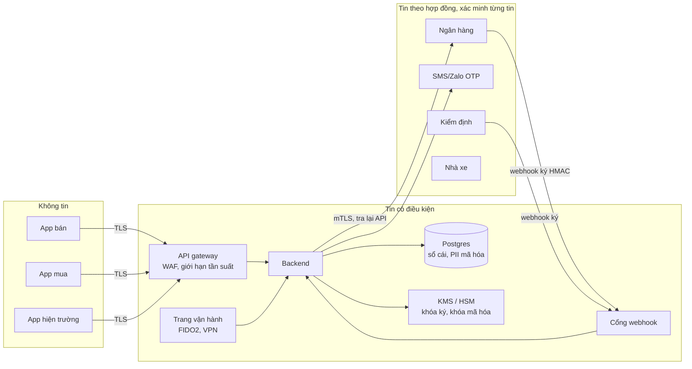

# 02 · Mô hình đe dọa (STRIDE, ưu tiên tiền)

Bản 25/10/2026. Phương pháp: liệt kê tài sản và ranh giới tin cậy, rồi đi từng mối đe dọa theo STRIDE (S giả mạo, T sửa đổi, R chối bỏ, I lộ thông tin, D từ chối dịch vụ, E leo thang quyền). Điểm rủi ro = Khả năng (1–5) × Tác động (1–5) **trước** biện pháp, kèm điểm còn lại **sau** biện pháp ở `03`. Điểm là ước lượng của người viết, chưa có dữ liệu sự cố thật.

## 1. Tài sản

| Mã | Tài sản | Vì sao quý |
|---|---|---|
| TS1 | Tiền cọc + phí trong tài khoản đảm bảo | Tiền thật của bên mua |
| TS2 | Lệnh chi/hoàn tới ngân hàng | Một lệnh sai là tiền đi mất, không hủy được |
| TS3 | Sự thật "đã nhận tiền" (trả thẳng, công nợ) | Quyết định quyết toán, quyết định bốc hàng |
| TS4 | Hợp đồng, phụ lục, biên bản nghiệm thu (nội dung + chữ ký) | Căn cứ tiền và trước tòa |
| TS5 | Tài khoản nhận tiền đã chụp | Đích của tiền |
| TS6 | Phiên đăng nhập, số điện thoại, OTP | Chìa khóa mọi thao tác |
| TS7 | Dữ liệu cá nhân: SĐT, CCCD, ảnh mặt, số tài khoản, tọa độ vườn | Nghị định/luật dữ liệu cá nhân; lừa đảo |
| TS8 | Khóa bí mật: HMAC webhook, khóa ký QR, khóa niêm phong PDF, khóa mã hóa PII | Lộ là giả mọi thứ |
| TS9 | Nhật ký kiểm toán, lịch sử trạng thái | Chứng minh ai làm gì |
| TS10 | Giá tham khảo, uy tín | Bị thao túng thì ép giá, lừa người lạ |

## 2. Tác nhân đe dọa

Kẻ lừa đảo bên ngoài (giả nhân viên, giả ngân hàng, giả tài xế); bên mua gian (không trả, ép loại, giả đã trả); người bán gian (giả xác nhận thiếu, hàng tráo, giữ cọc); người nhà / người giúp vượt quyền; nhân viên AgiViet lạm quyền hoặc bị mua chuộc; nhân viên bên mua làm ngoài; kẻ chiếm SIM; tội phạm rửa tiền; đối tác (ngân hàng mô phỏng, nhà xe, kiểm định) bị chiếm; lỗi lập trình (hai worker, gọi lặp).

## 3. Ranh giới tin cậy

Luật ranh giới: mọi thứ từ thiết bị là **lời đề nghị**; mọi thứ từ đối tác là **tin cần xác minh lại** (chữ ký + tra lại); chỉ DB và KMS giữ sự thật.

## 4. Bảng đe dọa (ưu tiên tiền)

| Mã | STRIDE | Đe dọa | Kịch bản cụ thể | K×T | Biện pháp chính (mã ở `03`) |
|---|---|---|---|---|---|
| T01 | S | **Giả xác nhận đã nhận tiền** (cọc) | Bên mua gửi ảnh UNC sửa; hoặc nhân viên bên mua nhắn VH "đã chuyển rồi, mở đơn đi" | 4×5=20 | Cọc chỉ ghi từ ngân hàng hạng A (B01, B02); VH không có nút "xác nhận cọc" một người (B09) |
| T02 | S | **Giả xác nhận đã nhận trả thẳng** | Nhân viên bên mua cầm máy chị Năm ở vườn bấm "Đã nhận đủ 32.200.000"; người giúp bấm hộ | 4×5=20 | OTP `money_received` gắn số tiền (B05), người giúp bị chặn API + DB (B07), mã giao dịch NH bắt buộc, UNIQUE theo tổ chức nhận (D-10) |
| T03 | S/T | **Webhook giả / phát lại** | Lộ URL webhook; kẻ gian gửi "deposit_received"; hoặc phát lại một webhook thật để ghi hai lần | 3×5=15 | HMAC + timestamp ±5' + nonce (B01), UNIQUE mã sự kiện (đã có), tra lại API trước khi ghi (B02), mTLS/allowlist IP |
| T04 | T | **Sửa số tiền phía client** | Sửa JSON: cọc 1.000 đ thay 13.938.000; sửa giá trong lệnh tạo đơn | 4×4=16 | Server tự tính mọi số tiền từ phiên bản hợp đồng; bỏ qua số từ client (B04); DB CHECK công thức (đã có ở `order_versions`, `settlements`) |
| T05 | T | **Đua điều kiện khi quyết toán hai lần** | Hai worker hoặc bấm lặp chạy quyết toán cùng lúc → hai bộ lệnh chi | 3×5=15 | Khóa hàng đơn, UNIQUE quyết toán cuối, UNIQUE lệnh theo căn cứ, ngăn tiền trong lệnh không âm (B06, đã có phần lớn) |
| T06 | S/E | **Chiếm tài khoản qua SIM swap / OTP** | Kẻ gian làm lại SIM số chị Năm, đăng nhập máy mới, đổi tài khoản nhận tiền, chờ quyết toán | 3×5=15 | Thiết bị mới + khôi phục ⇒ chờ 72 giờ cho thao tác tiền; đổi tài khoản cần OTP **số cũ** + yếu tố thứ hai; báo kênh cũ và liên hệ dự phòng; lệnh chi theo tài khoản chụp trong hợp đồng; giữ lệnh khi tài khoản mới (B10) |
| T07 | E | **Người giúp vượt quyền** | Cháu (người giúp) đổi tài khoản nhận về tài khoản của mình; hoặc được thêm vai chủ để ký | 3×4=12 | Kiểm quyền theo hành động ở API, DB chặn (B07, D-13, D-14) |
| T08 | E/T | **Nhân viên nội bộ lạm quyền** | VH-DS lập lệnh hoàn về tài khoản người quen; VH-QL mở khóa tài khoản kẻ gian; DBA sửa sổ cái | 2×5=10 | Hai người cho mọi thao tác tiền (B09), vai DB tách, sổ cái append-only, nhật ký WORM (B12), tách quyền VH (N-10), giám sát R4/R6 |
| T09 | S | **Lừa xin mã OTP** | "Nhân viên AgiViet" gọi: "Chị đọc mã để nhận tiền cọc" | 5×4=20 | Tin OTP ghi rõ việc + số tiền + "không đọc cho ai, kể cả nhân viên AgiViet" (B05); OTP đổi tài khoản không bao giờ đi một mình; nhân viên không hỏi OTP (08 mục 1); thẻ nhân viên QR có chữ ký để người bán kiểm |
| T10 | S/T | **Giả mạo QR VietQR (thay số tài khoản)** | Dán đè QR in; sửa ảnh QR gửi qua Zalo; mã độc trên máy kế toán | 3×5=15 | QR chỉ dựng ở server từ lệnh đã chụp; app soát QR trước khi hiện (`vietqr.mjs`); hiện tên chủ + 4 số cuối để so với app ngân hàng; cọc chỉ tính khi vào đúng tài khoản ảo (B13) |
| T11 | S | **Giả tài xế nhận hàng** | Người lạ tới vườn xưng tài xế của Đồng Xanh, chở hàng đi | 3×4=12 | Thẻ chuyến QR ký Ed25519 gắn biển số + tài xế; QR nhận hàng dùng một lần gắn người nhận chỉ định; người bán quét bằng app mình (B14) |
| T12 | T/R | **Sửa PDF sau ký / chối đã ký** | Bên mua sửa giá trong PDF rồi gửi tòa; người bán nói "tôi không ký bản này" | 3×4=12 | Ký trên băm nội dung chuẩn tắc, chuỗi phiên bản, niêm phong Ed25519, trang xác minh (B15); bằng chứng OTP gắn băm (D-15) |
| T13 | R | **Lách ra ngoài để né phí** | Khai giá thấp, trả phần chênh ngoài; liên lạc qua Zalo trước cọc | 5×2=10 | Đã có ở `05` (giá tính cọc, che liên lạc, theo dõi cặp); bổ sung R5 |
| T14 | T | **Rửa tiền / giao dịch vòng** | A mua B, B mua C, C mua A với số tương đương; nộp cọc từ tài khoản lạ rồi hủy để hoàn "sạch" | 2×5=10 | Hoàn chỉ về tài khoản nguồn (L4), R1 vòng, R3 cọc–hủy lặp, R2 một tài khoản nhiều tổ chức, báo cáo cho ngân hàng đối tác (B16) |
| T15 | S/T | **Đổi tài khoản nhận tiền ngay trước quyết toán** | Như T06, hoặc chủ thật bị ép | 3×5=15 | Như T06; đích lệnh = tài khoản trong hợp đồng (D-07) |
| T16 | I | **Lộ dữ liệu cá nhân / IDOR** | Đổi `:don_id` trong URL để xem đơn đối thủ; trang xác minh PDF lộ hợp đồng | 4×3=12 | Kiểm quyền mọi truy vấn theo tổ chức, RLS (D-18), uuid không đoán được (đã có), trang công khai tối thiểu (N-05), mã hóa PII (B17) |
| T17 | D | **Bơm SMS OTP** (SMS pumping), khóa người dùng | Bot gọi gửi OTP hàng loạt tốn tiền; cố sai OTP để khóa tài khoản người khác | 4×3=12 | Giới hạn theo số/người/IP/toàn cục (`rate-limit.mjs`), CAPTCHA sau ngưỡng, khóa thử thách chứ không khóa tài khoản |
| T18 | S | **Webhook / kết quả kiểm định giả** | Giả kết quả "người bán sai" để lấy cọc | 2×4=8 | Kênh đối tác ký, đối chiếu QR niêm phong (N-11) |
| T19 | T | **Thao túng giá tham khảo** | Vài đơn rẻ giữa tài khoản liên quan để kéo `P_tk` | 3×3=9 | Đã có ở `05` (Q18, LA-10); thêm R1 |
| T20 | E | **Mã mô phỏng lọt production** | Đồng hồ tua thời gian, bảng phát sự kiện ngân hàng | 2×5=10 | N-07 |
| T21 | T | **Phát lại lệnh tới ngân hàng** | Lỗi mạng, gửi lại lệnh chi không có khóa | 3×5=15 | Mã lệnh là khóa chống lặp với ngân hàng (cần ngân hàng hỗ trợ), tra trạng thái trước khi gửi lại (B03) |
| T22 | S | **"Thất bại" rồi "thành công" muộn** | Lệnh báo thất bại, VH lập lệnh thay, lệnh cũ thành công | 2×5=10 | Thất bại chỉ là cuối khi tra lại xác nhận; lệnh thay qua VH2 (`01` 3.3) |
| T23 | I | **Lộ khóa** | Khóa HMAC trong mã nguồn/biến môi trường log ra | 2×5=10 | KMS, xoay khóa có `kid`, quét bí mật trong CI (B18) |
| T24 | R | **Chối thao tác vận hành** | "Tôi không duyệt lệnh đó" | 2×3=6 | Bản ghi phê duyệt có step-up FIDO2, băm nội dung đã duyệt (`four-eyes.mjs`), WORM |

## 5. Mười rủi ro lớn nhất (trước biện pháp)

1. T01 giả xác nhận cọc (20) · 2. T02 giả xác nhận trả thẳng tại vườn (20) · 3. T09 lừa xin OTP (20) · 4. T04 sửa số tiền phía client (16) · 5. T03 webhook giả/phát lại (15) · 6. T05 quyết toán hai lần (15) · 7. T06/T15 chiếm tài khoản + đổi tài khoản nhận (15) · 8. T10 QR VietQR bị thay (15) · 9. T21 phát lại lệnh ngân hàng (15) · 10. T07 người giúp vượt quyền / T11 giả tài xế (12).

Rủi ro còn lại sau biện pháp: `07-danh-gia-thanh-that.md` mục 4.

## 6. Giả định của mô hình

- Ngân hàng đối tác có: tài khoản ảo theo đơn hoặc mã tham chiếu tin được, webhook ký, API tra giao dịch, sao kê ngày, khóa chống lặp lệnh chi. **Chưa được xác nhận** với ngân hàng thật nào.
- Nhà mạng không cung cấp API "SIM vừa đổi" cho AgiViet (giả định xấu nhất); nếu có qua đối tác xác thực, dùng làm tín hiệu thêm.
- Người bán dùng điện thoại Android tầm thấp, có thể dùng chung máy trong gia đình.
