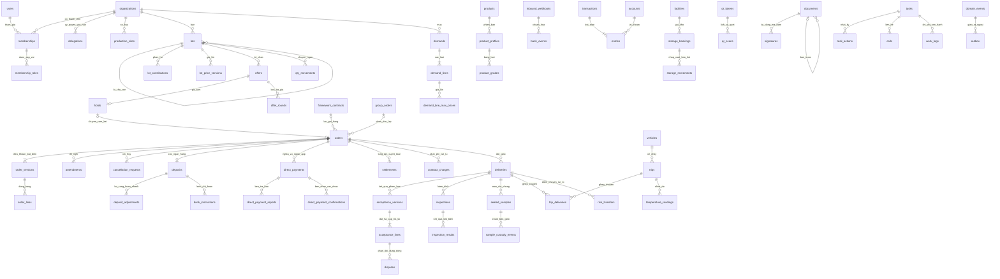

# 01. Mô hình dữ liệu

Đọc SQL trong `db/migrations/` để biết đầy đủ cột, CHECK và trigger. Sơ đồ thể hiện các khóa ngoại chính; một số liên kết vòng được thêm sau khi hai bảng đã tồn tại. `entity/entity_id` của lịch sử và việc là liên kết đa hình, không có FK tới một bảng duy nhất.

## Các nguồn gốc khác nhau không trộn vào nhau

| Dữ liệu | Bảng | Ý nghĩa |
|---|---|---|
| Hợp đồng đang xử lý | `orders`, `order_versions`, `signatures` | Chỉ hiệu lực sau đúng điều kiện ký và cọc |
| Đơn nền chi tiết | `historical_trades` | Dữ liệu thử nhập để tham khảo giá/mối quen; không có sổ tiền quá khứ |
| Giá giả định | `mkt.external_prices` | Nhãn nguồn ngoài/giả định; không dùng làm giá tính cọc |
| Snapshot nguồn | `ops.seed_sources` | Toàn bộ 13 mục JSON và SHA-256 để kiểm tra nạp |
| Kế hoạch bao tiêu nhập | `imported_offtake_plans`, `imported_offtake_batches` | Bảo toàn dữ kiện nguồn; liên kết đơn thật sau khi có đủ hồ sơ |
| Dư nợ khung mở đầu | `framework_opening_exposures` | Dư nợ thực ghi quyền đòi; lịch sắp giao là phần dùng hạn mức |

## Ràng buộc tiêu biểu

- Một tổ chức có một tài khoản ngân hàng `active`; hai yếu tố xác minh và thời gian chờ được lưu.
- Đơn mua và bán có hai tổ chức khác nhau. Phiên bản tiền kiểm lại công thức cọc, phí, giá tính cọc và giá trị hàng.
- `effective_version_no` là FK hoãn tới đúng phiên bản của chính đơn, đồng thời phải có chữ ký đúng bên.
- Một đợt có nhiều bản nghiệm thu bất biến; dòng chỉ thay trạng thái. Tổng dòng bằng lượng cân, kiểm cuối transaction kể cả bản chưa có dòng nào.
- `write_xid` khóa bút toán và dòng nghiệm thu sau transaction tạo chúng. Đây là dấu đóng cấu trúc, không phải ID công khai.
- Một xe không nhận các khoảng chuyến chồng nhau bằng exclusion GiST; tải chuyến kiểm theo lượng gram.
- Các bảng tiền không cấp DELETE/TRUNCATE cho vai ứng dụng; bảng chứng cứ và sổ có trigger append-only.

Các FK tới tài khoản nhận tiền giữ bản cũ để lệnh đã phát không tự chuyển sang tài khoản mới. Không đổi tên hoặc xóa tài khoản cũ để “dọn dữ liệu”.

## Bổ sung LS và bảo mật 0021–0029

- `settlements`: số phiên bản, liên kết trước, cờ hiệu lực và bản điều chỉnh; nghĩa vụ chênh tự sinh, lịch sử bất biến.
- `signatures.ops_decision_id`: chỉ phương thức `quyet_dinh_van_hanh` cho TH-040b; OTP trỏ `evt.otp_challenges`.
- `order_versions.ref_price_source/grade_code/as_of/external_id`: xuất xứ snapshot; giá ngoài chỉ hiển thị và `P_coc=P`. `mkt.reference_prices` chỉ tổng hợp giao dịch đủ mẫu.
- `core.membership_role_grants` giữ lịch sử cấp vai, `core.membership_roles` là view tự cập nhật lọc vai đã hết cooling. Các hàm kiểm quyền cũ đọc view này; migration chỉ đổi tên bảng cũ, giữ FK/trigger/dữ liệu.
- `cmd.login_principals` là ánh xạ login tin cậy, không cho app ghi; `ops.bank_return_tasks` giữ việc hoàn tiền đến muộn; `evt.audit_chain` giữ chuỗi hash kiểm toán.

FK OTP chữ ký và CHECK chứng cứ xác nhận tiền dùng NOT VALID khi nâng cấp để giữ nguyên chứng từ lịch sử; mọi INSERT mới vẫn bị kiểm. Không tự tạo OTP đã xác minh hay sửa lịch sử để VALIDATE. DB có dữ liệu cũ cần kiểm kê riêng trước khi validate. Không sửa checksum migrations đã áp.

## Bổ sung sau N-01…N-16 (0030–0032)

- Tiền theo đơn/khung có `deposit_pending`, `excess_held`, `excess_in_instruction`; không gộp vào C hay F. `ledger.v_deposit_conservation` là view đối chiếu C.
- `settlements.additional_hold_vnd` chụp khoản giữ thêm; `hold_formula_version=2` bắt buộc trên bản mới. Bản trước nâng cấp mang phiên bản 1 để không tính lại quyết toán lịch sử. `disputes.claim_kind` phân biệt chất lượng và thiếu lượng; lượng/đơn và kiểm định/đợt được kiểm chéo.
- `policy_versions.approval_decision_id` UNIQUE FK tới quyết định hai người, chứa đúng toàn bộ nội dung chính sách trong `detail.policy`.
- `qr_tokens.id` đóng vai trò jti; `invited_phone_hash` ràng buộc số đích. Challenge thêm purpose `invitation_accept`.
- `direct_payment_confirmations.cash_warning` là cột sinh tự động; `bank_evidence_id` UNIQUE FK tới chứng cứ API cho đối soát ngoại lệ.
- `ops.payout_callbacks` là bảng mới duy nhất: FK tới lệnh, tài khoản, cuộc gọi và người xác nhận. `bank_instructions.callback_required/target_activated_at` giữ snapshot điều kiện gọi lại. Lệnh mới cần gọi lại tự tạo việc V08 cho finance.
- `ops.bank_return_tasks` có đích nguồn bất biến và `return_bank_event_id` UNIQUE FK; không chỉ là cờ hoàn xong do người vận hành tự khai.

Tổ hợp tác (`coop_group`) vẫn giữ danh tính, thành viên và lô phục vụ phối hợp, nhưng không đứng nhận tiền chung. Giao dịch v2 dùng đơn con/tài khoản từng hộ. HTX (`cooperative`) vẫn được dùng mô hình pháp nhân/lô gộp. Seed bỏ tài khoản chung Tổ hợp tác Tôm sạch Hòa Tú khỏi bảng giao dịch, giữ nguồn gốc trong `seed_sources`; không bịa danh tính hộ mới.
