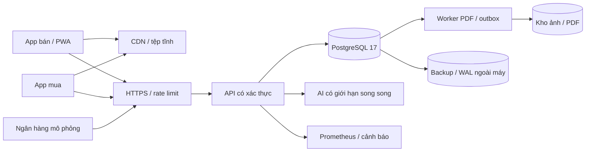

# 00 · Kiến trúc triển khai

> Phạm vi lịch sử 25/10/2026: khảo sát/bộ đo stub. Stack ứng dụng thật trên Oracle cập nhật ở [06](06-trien-khai-oracle-free.md), kết quả tiếp phiên ở [05](05-danh-gia-thanh-that.md). Không dùng Compose stub để triển khai app thật.

Ngày khảo sát: 25/10/2026. Đây là kế hoạch cho hai app bán/mua, API, PostgreSQL 17, AI, PDF, QR và ngân hàng **mô phỏng**. Chưa triển khai lên nhà cung cấp. Chi phí dưới đây là ngân sách ước tính, không phải hóa đơn hay báo giá ràng buộc; giả định 1 USD = 26.000 đ để lập ngân sách, chưa tính thuế/phí chuyển đổi nếu nhà cung cấp chưa bao gồm.

## Chọn gì

Giai đoạn thi: chọn VPS tại Việt Nam, Compose, PostgreSQL 17 cùng máy; app tĩnh có thể đưa lên Firebase Hosting. Dùng object storage riêng cho ảnh/PDF và backup ngoài VPS. Không cần Kubernetes. Khi có người dùng thường xuyên hoặc tiền thật, tách DB, worker và có người trực trước khi tăng máy.

Sơ đồ là kiến trúc đích. Compose trong repo hiện dùng backend/AI giả lập và volume tệp cục bộ; chưa có app bán/mua thật hay object storage tích hợp.

## Quy mô và ngân sách tháng

Thi/pilot: giả định 2.000 người bán, 200 bên mua, 5 API request/s cao điểm, ảnh 20 GB truyền/tháng, DB 10–20 GB. Lớn hơn: 20.000 người bán, 2.000 bên mua, 50 request/s cao điểm, ảnh khoảng 500 GB truyền/tháng, DB 100 GB. Không lấy tải cao điểm nhân toàn bộ tháng. AI có dự phòng ngân sách riêng, không giả định GPU miễn phí.

| Phương án | Thi/pilot mỗi tháng | Lớn hơn mỗi tháng | Đánh đổi |
|---|---:|---:|---|
| A. VPS Việt Nam + Compose + PG17 | 0,9–1,8 triệu đ | 4–8 triệu đ | Chi phí thấp, gần người dùng; đội tự vá lỗi, backup, phục hồi; một VPS là điểm hỏng đơn |
| B. Cloud Run Singapore + Cloud SQL PG17; Fly là lựa chọn thay thế | 3–6 triệu đ | 12–25 triệu đ | Giảm công vận hành DB, có khả năng HA; phí DB nền và truyền dữ liệu cao hơn, giới hạn autoscale để bảo vệ DB |
| C. Firebase Hosting tệp tĩnh + API/DB của A | 0,9–1,9 triệu đ | 4,2–8,5 triệu đ | CDN/HTTPS và phát hành hai app thuận tiện; Firebase Hosting không thay PostgreSQL/API/worker |

Cấu phần A ở pilot: VPS 4 vCPU/8 GB khoảng 0,5–0,9 triệu; backup/object storage/giám sát 0,15–0,3 triệu; AI dự phòng 0,25–0,6 triệu. Quy mô lớn: hai app/API node hoặc API+worker riêng 1–2 triệu; DB 8–16 GB + máy dự phòng 1,5–3 triệu; storage/backup/giám sát 0,5–1 triệu; AI 1–2 triệu. Mức 8 GB cần đặt giới hạn bộ nhớ cho từng dịch vụ; không bật vô hạn worker.

Giá tham chiếu công khai để kiểm tra tính hợp lý: [Thinkmay VPS](https://saigon4.thinkmay.net/pricing/vps/) công bố gói 4 vCPU/8 GB/100 GB và trần tháng; [Vietnix](https://vietnix.vn/vps/) có giá tùy cấu hình và kỳ hạn. Chưa mua hay đánh giá chất lượng hai nhà cung cấp. Khoảng giá A là ngân sách chủ động, không gán nó cho một gói cụ thể.

B ở pilot: API/worker 0,3–1 triệu, managed DB 2–3,5 triệu, storage/backup/egress/giám sát 0,3–0,9 triệu, AI 0,3–0,6 triệu. Quy mô lớn dùng DB HA, API luôn ấm và worker riêng; đặt cảnh báo ngân sách. [Cloud Run](https://cloud.google.com/run/pricing) tính theo tài nguyên và chế độ billing; worker nền cần instance-based billing hoặc Jobs/queue có bảo đảm thực thi. Chưa xuất bản cấu hình Cloud SQL để lấy báo giá chính xác.

Lựa chọn Fly: [bảng giá chính thức](https://fly.io/pricing/) có Managed Postgres Basic 38 USD, Starter 72 USD, Launch 282 USD/tháng, storage 0,28 USD/GB-tháng. Basic + 20 GB là 43,6 USD, chưa gồm API/AI/egress; Launch + 100 GB là 310 USD. Gói nhỏ có HA không đồng nghĩa đủ RAM cho bộ dữ liệu tải trong repo. [Fly công bố hỗ trợ PG17](https://community.fly.io/t/you-asked-and-we-shipped-postgres-17-on-mpg/26430); phải kiểm tra phiên bản, region, extension và khả năng phục hồi của cluster thực tế trước khi chọn. Không đặt API ở Việt Nam nhưng DB ở châu Âu.

C chỉ đưa bundle HTML/CSS/JS, manifest, service worker và ảnh công khai lên Hosting. PDF riêng tư dùng URL ký có hạn từ object storage. [Firebase Hosting](https://firebase.google.com/pricing) có mức miễn phí 10 GB storage, 360 MB/ngày transfer; phần vượt lần lượt 0,026 USD/GB và 0,15 USD/GB. Với 50 GB tệp tĩnh truyền/tháng phân bố đều, dự phòng khoảng 6 USD phần vượt; ảnh 500 GB/tháng không mặc nhiên rẻ nếu phục vụ qua Hosting. Không cache API tiền/hợp đồng vào CDN công khai.

## Độ trễ đến người dùng Việt Nam

Chưa có đo RTT từ nhiều nhà mạng Việt Nam. Ước lượng lập kế hoạch: VPS trong nước 10–50 ms RTT mạng tốt; Singapore 35–90 ms; 4G yếu có thể 150–500 ms hoặc hơn với mất gói. Đây không phải SLA. Đo từ VNPT/Viettel/MobiFone và ít nhất một điểm ĐBSCL trước chọn nhà cung cấp. Tệp tĩnh CDN có thể giảm đường đi; DB luôn cùng region với API.

API ngắn mục tiêu p95 < 800 ms ở cao điểm; xác nhận QR < 1 giây nếu mạng tốt; PDF trả mã việc < 300 ms, hoàn thành p95 < 10 giây; AI có thể nhiều giây và luôn có nhập tay dự phòng. Đây là mục tiêu nghiệm thu, không phải kết quả hiện tại. Không giữ transaction DB trong lúc gọi AI/ngân hàng/sinh PDF.

## Backup, phục hồi, giám sát theo phương án

A: dump hàng đêm ra kho khác máy; mục tiêu ban đầu RPO 24 giờ/RTO 2 giờ. Khi cần RPO 5 phút, thêm base backup + lưu WAL liên tục, diễn tập và giám sát archive lag; dump đơn thuần không đạt mục tiêu này. Replication không thay backup.

B: bật automated backup/PITR và HA theo gói đã mua, lưu thêm bản export độc lập; đối chiếu với [hướng dẫn Cloud SQL](https://cloud.google.com/sql/docs/postgres/backup-recovery/backups). Mục tiêu RPO ≤ 5 phút/RTO ≤ 60 phút chỉ được công nhận sau diễn tập. C dùng cùng chính sách DB của A/B, giữ manifest của hai bundle để rollback đồng bộ API.

Cả ba: health/readiness tách biệt, histogram theo route, độ trễ hàng đợi, số lỗi webhook, DB connections/locks/disk/WAL và cảnh báo ngoài máy. Chi tiết thực thi và phần chưa có ở tài liệu 04–05.
